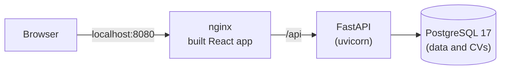

# Café Sinnoh

[](https://github.com/Vicram4/cafe-sinnoh/actions/workflows/ci.yml)

[Español](README.md) · **English**

Full-stack web app for a fictional artisan coffee shop: menu, online orders for in-store pickup, a loyalty points program with rewards, reviews, job applications with CV upload and a complete admin panel.

The brand is inspired by a place, the Sinnoh region: mountains, forests and cold weather. Some products pay tribute to a Pokémon, always with a legal notice. The illustrations show only the product, never characters.

> Portfolio project. This is a non-profit fan project and is not affiliated with Nintendo, Game Freak or The Pokémon Company. It does not use any official artwork.

The user interface is in Spanish; code, database and API are in English.

## Features

**Customers**
- Menu with search, category filter and sorting; product pages showing each product's inspiration.
- Cart and pickup orders, validated against opening hours and a minimum lead time.
- Personal account: profile, order history, points and reward redemption.
- Reviews only for products that were bought and picked up, moderated before publishing.
- Careers page (application with a PDF CV) and contact form.
- Demo mode: one-click customer and admin test accounts, with data reset daily.
- Light and dark mode, responsive layout and support for `prefers-reduced-motion`.

**Admin**
- Dashboard with stats, orders (state machine), products (CRUD), review moderation, job applications with CV download, messages and users (roles and deactivation).

## Tech stack

| Layer | Technologies |
|---|---|
| Frontend | React 19, TypeScript, Vite, Tailwind CSS v4, React Router, TanStack Query, react-hook-form + Zod |
| Backend | Python 3.14, FastAPI, SQLAlchemy 2 (sync), Alembic, Pydantic, PyJWT, pwdlib (Argon2) |
| Database | PostgreSQL 17 |
| Infrastructure | Docker, Docker Compose, nginx, GitHub Actions |
| Quality | pytest, Vitest, Testing Library, Oxlint, pip-audit, npm audit |

## Architecture



- **Layered backend:** `api` (HTTP routes), `services` (business logic, no HTTP), `models` (SQLAlchemy), `schemas` (Pydantic; internal data such as password hashes is never exposed).
- **The backend is the source of truth:** prices, availability, roles, statuses and points are always computed and validated on the server. The client never sends a price.
- **Same origin:** nginx serves the app and proxies `/api` to the backend, so no CORS is needed in production.

## Notable technical decisions

**Security**
- Two-part session: a short-lived JWT kept only in memory (never in `localStorage`) plus a refresh token in an `HttpOnly` + `SameSite=Strict` cookie that JavaScript cannot read. An XSS cannot steal the session, yet it survives a page reload.
- Refresh tokens rotate on every use: if an already-used token shows up again (a sign it was copied), the whole session is revoked. Only their hash is stored, and logging out also revokes the session on the server.
- Every request loads the user from the database: role changes and deactivations take effect immediately, even if the token is still valid.
- Login attempts are rate-limited per account + IP and per IP, checked before the password. Only an HMAC of the email is stored, never the email itself.
- Passwords need at least 8 characters; common passwords and those containing the user's email are rejected (instead of uppercase/symbol rules, following NIST guidance).
- Public forms (sign-up, contact and careers) are protected against spam with a per-IP submission limit and an invisible honeypot field, with no captcha.
- The app refuses to start with a `SECRET_KEY` shorter than 32 bytes, and configuration errors never print secrets.
- CVs are validated by extension, MIME type and the `%PDF-` signature, stored under a random name and downloadable by admins only.

**Data**
- Money is always stored in cents (integers).
- Orders keep a snapshot of each product's name and price, so order history never changes when the menu does.
- Points are a ledger: the balance is a sum, never a column that could drift. Points for an order can never be awarded twice.

**Frontend**
- Route-based code splitting: the initial JavaScript is 82 KB gzipped, and only admins ever download the admin panel.
- One cart per account on the same browser, merged on login without duplicating quantities.

## Running with Docker

Requirements: Git and Docker Desktop.

1. Copy the configuration templates:
   ```bash
   cp .env.example .env
   cp backend/.env.example backend/.env
   ```
2. In `.env`, choose a PostgreSQL password (avoid `@ : / % #`). In `backend/.env`, use the same password in `DATABASE_URL` and `TEST_DATABASE_URL`, and generate a `SECRET_KEY` (no local Python needed):
   ```bash
   docker run --rm python:3.14-slim python -c "import secrets; print(secrets.token_urlsafe(64))"
   ```
3. Start everything:
   ```bash
   docker compose --profile app up -d --build
   ```
4. Load the sample menu and rewards:
   ```bash
   docker compose exec backend python -m app.seed.seed_products
   docker compose exec backend python -m app.seed.seed_rewards
   ```
5. Open **http://localhost:8080** and sign up. To make your account an admin (use the user and database from your `.env`):
   ```bash
   docker compose exec db psql -U sinnoh -d cafe_sinnoh -c "update users set role='ADMIN' where email='you@example.com';"
   ```

Database migrations run automatically when the backend starts.

**Demo mode (optional).** For the public version: set `VITE_DEMO_MODE=true` in `.env` and `DEMO_MODE=true` in `backend/.env`, rebuild, and create the test accounts with `docker compose exec backend python -m app.seed.seed_demo`. The login page will show "Entrar como cliente" and "Entrar como admin" buttons. `python -m app.seed.reset_demo` restores the demo to its initial state; it deletes all data, so it only runs with `DEMO_MODE=true`.

## Development and tests

The full guide (in Spanish) is in [docs/development.md](docs/development.md): local development without Docker, the test database and dependency audits.

| | Command | Coverage |
|---|---|---|
| Backend | `pytest` (in `backend/`) | 130 tests: auth, demo mode, persistent sessions, passwords, anti-spam, orders, points, admin permissions, CVs and login rate limiting, against a PostgreSQL test database |
| Frontend | `npm test` (in `frontend/`) | 46 tests: CSP, page titles, demo login, session and token refresh, API client, per-user cart, careers form, theme and formatting |

GitHub Actions CI runs the tests, lint, build, dependency audits and Docker image builds on every push and every Monday even without changes. Dependabot proposes dependency updates weekly.

## Project structure

```
backend/
  app/
    api/v1/      HTTP routes and auth dependencies
    services/    Business logic (orders, points, reviews, CVs, login...)
    models/      SQLAlchemy models
    schemas/     Pydantic schemas
    seed/        Sample data (idempotent)
  alembic/       Migrations
  tests/
frontend/
  src/
    pages/ layouts/ components/
    context/ hooks/     Global state (session, cart, theme)
    services/api/       Centralized HTTP client
docs/            Development guide and project status (in Spanish)
```

## Next steps

- Screenshots.
- Deployment: HTTPS, backups and a Content-Security-Policy.

## Author

Built by [Vicram4](https://github.com/Vicram4).
