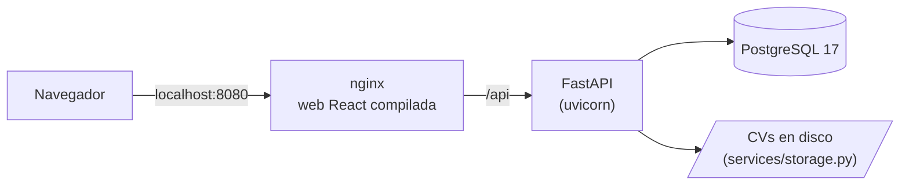

# Café Sinnoh

[](https://github.com/Vicram4/cafe-sinnoh/actions/workflows/ci.yml)

**Español** · [English](README.en.md)

Aplicación web full-stack para una cafetería artesanal ficticia: carta, pedidos online para recoger en el local, programa de puntos con recompensas, reseñas, empleo con subida de CV y un panel de administración completo.

La marca se inspira en un lugar, la región de Sinnoh: montañas, bosques y frío. Algunos productos rinden homenaje a un Pokémon, siempre con un aviso legal.

> Proyecto de portfolio. Es un proyecto de fans sin ánimo de lucro y no está afiliado a Nintendo, Game Freak ni The Pokémon Company. No usa ningún recurso gráfico oficial.

## Funcionalidades

**Clientes**
- Carta con búsqueda, filtro por categoría y orden; ficha de cada producto con su inspiración.
- Carrito y pedido para recoger, con validación de horario y antelación mínima.
- Cuenta personal: datos, historial de pedidos, puntos y canje de recompensas.
- Reseñas solo de productos comprados y recogidos, moderadas antes de publicarse.
- Trabaja con nosotros (candidatura con CV en PDF) y formulario de contacto.
- Modo claro y oscuro, diseño adaptable y respeto a `prefers-reduced-motion`.

**Administración**
- Panel con estadísticas, pedidos (máquina de estados), productos (CRUD), moderación de reseñas, candidaturas con descarga de CV, mensajes y usuarios (roles y desactivación).

## Stack

| Capa | Tecnologías |
|---|---|
| Frontend | React 19, TypeScript, Vite, Tailwind CSS v4, React Router, TanStack Query, react-hook-form + Zod |
| Backend | Python 3.14, FastAPI, SQLAlchemy 2 (síncrono), Alembic, Pydantic, PyJWT, pwdlib (Argon2) |
| Base de datos | PostgreSQL 17 |
| Infraestructura | Docker, Docker Compose, nginx, GitHub Actions |
| Calidad | pytest, Vitest, Testing Library, Oxlint, pip-audit, npm audit |

## Arquitectura



- **Backend por capas:** `api` (rutas HTTP), `services` (lógica de negocio, sin HTTP), `models` (SQLAlchemy), `schemas` (Pydantic; nunca exponen datos internos como el hash de la contraseña).
- **El backend es la fuente de verdad:** precios, disponibilidad, roles, estados y puntos se calculan y validan siempre en el servidor. El cliente nunca envía un precio.
- **Mismo origen:** nginx sirve la web y reenvía `/api` al backend, así que no hace falta CORS en producción.

## Decisiones técnicas destacadas

**Seguridad**
- Sesión en dos piezas: un JWT de corta duración solo en memoria (nunca en `localStorage`) y un token de renovación en una cookie `HttpOnly` + `SameSite=Strict` que JavaScript no puede leer. Un XSS no puede robar la sesión, y aun así se conserva al recargar la página.
- Los tokens de renovación rotan en cada uso: si reaparece uno ya usado (señal de copia), se revoca toda la sesión. En la base de datos solo se guarda su hash, y cerrar sesión la revoca también en el servidor.
- Cada petición consulta el usuario en la BD: un cambio de rol o una desactivación surten efecto al instante, aunque el token siga siendo válido.
- Límite de intentos de login por cuenta + IP y por IP, comprobado antes que la contraseña. Se guarda un HMAC del email, nunca el email en claro.
- Contraseñas de 8 caracteres como mínimo, rechazando las más comunes y las que contienen el propio email (en lugar de reglas de mayúsculas y símbolos, según las recomendaciones del NIST).
- Formularios públicos (registro, contacto y empleo) protegidos contra spam con un límite de envíos por IP y un campo trampa invisible, sin captcha.
- La app no arranca con una `SECRET_KEY` de menos de 32 bytes, y los errores de configuración no muestran secretos.
- CVs validados por extensión, tipo MIME y firma `%PDF-`; se guardan con un nombre aleatorio y solo los descarga un admin.

**Datos**
- Dinero siempre en céntimos (enteros).
- Los pedidos guardan una copia del nombre y el precio de cada producto: el historial no cambia aunque cambie la carta.
- Los puntos son un libro de movimientos: el saldo es una suma, nunca una columna que pueda desincronizarse. Los puntos de un pedido no pueden otorgarse dos veces.

**Frontend**
- Code splitting por rutas: el JavaScript inicial pesa 82 KB comprimido, y el panel de admin solo lo descarga quien entra en él.
- Un carrito por cuenta en el mismo navegador, que se une al iniciar sesión sin duplicar cantidades.

## Puesta en marcha con Docker

Requisitos: Git y Docker Desktop.

1. Copia las plantillas de configuración:
   ```bash
   cp .env.example .env
   cp backend/.env.example backend/.env
   ```
2. En `.env`, elige una contraseña para PostgreSQL (sin `@ : / % #`). En `backend/.env`, usa la misma en `DATABASE_URL` y `TEST_DATABASE_URL`, y genera una `SECRET_KEY` (sin instalar Python, con Docker):
   ```bash
   docker run --rm python:3.14-slim python -c "import secrets; print(secrets.token_urlsafe(64))"
   ```
3. Arranca todo:
   ```bash
   docker compose --profile app up -d --build
   ```
4. Carga la carta y las recompensas de ejemplo:
   ```bash
   docker compose exec backend python -m app.seed.seed_products
   docker compose exec backend python -m app.seed.seed_rewards
   ```
5. Abre **http://localhost:8080** y regístrate. Para convertir tu cuenta en administradora (usa el usuario y la base de datos de tu `.env`):
   ```bash
   docker compose exec db psql -U sinnoh -d cafe_sinnoh -c "update users set role='ADMIN' where email='tu@email.com';"
   ```

Las migraciones de la base de datos se aplican solas al arrancar el backend.

## Desarrollo y tests

La guía completa está en [docs/development.md](docs/development.md): desarrollo sin Docker, base de datos de test y auditorías.

| | Comando | Qué cubre |
|---|---|---|
| Backend | `pytest` (en `backend/`) | 117 tests: autenticación, sesión persistente, contraseñas, anti-spam, pedidos, puntos, permisos de admin, CVs y límite de login, contra un PostgreSQL de test |
| Frontend | `npm test` (en `frontend/`) | 38 tests: sesión y renovación del token, cliente de la API, carrito por usuario, formulario de empleo, tema y formatos |

La CI de GitHub Actions ejecuta en cada push, y cada lunes aunque no haya cambios, los tests, el lint, el build, las auditorías de dependencias y la construcción de las imágenes Docker. Dependabot propone cada semana las actualizaciones de dependencias.

## Estructura

```
backend/
  app/
    api/v1/      Rutas HTTP y dependencias de autenticación
    services/    Lógica de negocio (pedidos, puntos, reseñas, CVs, login...)
    models/      Modelos SQLAlchemy
    schemas/     Esquemas Pydantic
    seed/        Datos de ejemplo (idempotentes)
  alembic/       Migraciones
  tests/
frontend/
  src/
    pages/ layouts/ components/
    context/ hooks/     Estado global (sesión, carrito, tema)
    services/api/       Cliente HTTP centralizado
docs/            Guía de desarrollo y estado del proyecto
```

## Próximos pasos

- Ilustraciones propias de los productos y capturas de pantalla.
- Deployment: sesión definitiva, almacenamiento de CVs en la nube y Content-Security-Policy.

## Autor

Desarrollado por [Vicram4](https://github.com/Vicram4).
